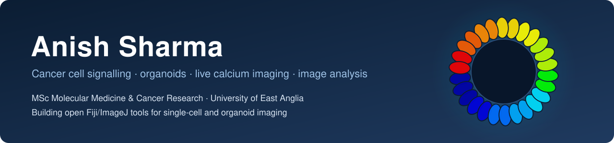

  

### About me

I am an MSc Molecular Medicine and Cancer Research student at the **University of East Anglia** in Norwich, UK. In the Williams Laboratory I study how individual cells in **patient-derived colorectal cancer organoids** respond to receptor signals, using **live confocal calcium imaging**, and I build the **Fiji/ImageJ tools** that turn those movies into reproducible single-cell data.

- 🔬 **Now:** single-cell calcium signalling in organoids
- 🎯 **Next:** a funded PhD (2027) in cancer cell signalling, organoid biology or quantitative imaging
- 📍 Norwich, United Kingdom

### Tools I have built

| Tool | What it does | Built with |
|---|---|---|
| **CalciumMate v2** | Turns raw confocal calcium movies into ΔF/F₀ movies and single-cell traces, re-uses the same cell outlines across paired recordings, and compares two drug responses cell by cell, including where in each cell the signal starts. | Fiji macro · R |
| **Organoid morphometry** | Finds every organoid in a whole-well brightfield scan, measures size and shape, pre-classifies spheroid, budded, merged or debris, and lets a person confirm each call in seconds. | Fiji · Cellpose |
| **Immuno channel pairs** | Batch-exports every two-channel combination of four-channel immunofluorescence images, with identical brightness and scale bars across a whole experiment. | Fiji macro |

Public releases are on the way.

### Toolbox

### Education

- **MSc Molecular Medicine and Cancer Research** · University of East Anglia, UK · 2026 – 2027
- **BSc Microbiology** · Parul University, India · 2021 – 2024 · First Class with Distinction

### Get in touch

